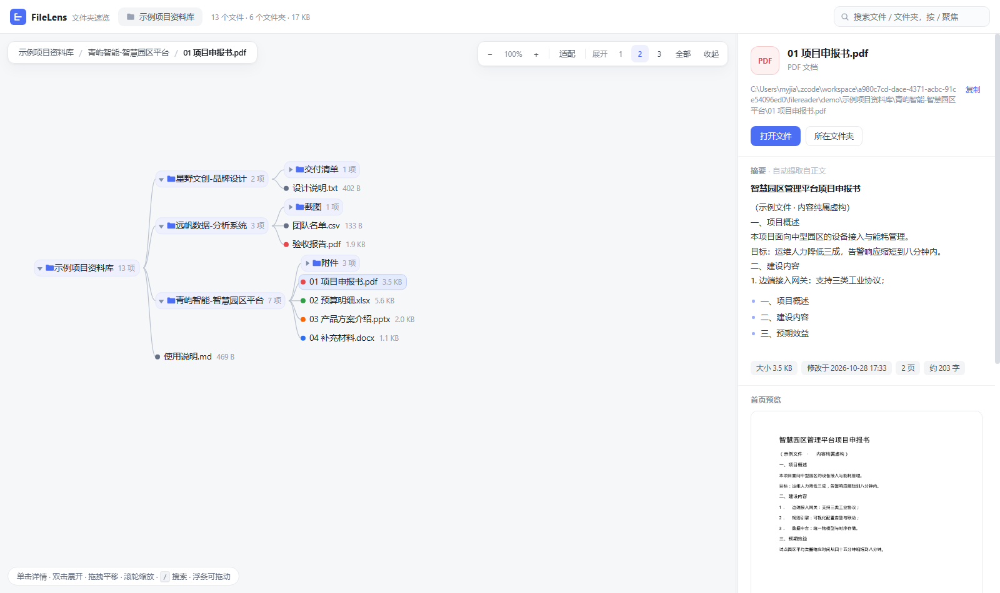

# FileLens · 文件夹速览

**把一个又深又乱的文件夹，变成一张可以探索的地图。**

收到一个几百上千个文件、十几层深的资料文件夹？不用一层层点开——FileLens 把它渲染成一棵
可交互的树状图，**单击任意节点即可看到这个文件的摘要与核心内容**，文件夹节点则给出构成统计。
纯本地运行、零构建、无 CDN 依赖，适合评审材料、项目交接、归档盘点等场景。



## 特性一览

- 🗺 **树状图导航** —— 可折叠展开（1/2/3 层快捷键、全部展开、一键收起）；缩进跟随实际宽度，连线与节点结构上不会交叉
- 📄 **单击看摘要** —— 文件：标题 / 开头段落 / 小标题要点（提取式，非 AI 生成）、正文预览、页数字数统计、PDF 首页截图；文件夹：文件数、总大小、类型构成条形图、最大文件 Top5、最近修改 Top5
- 🔍 **实时搜索** —— `/` 聚焦，非匹配自动淡出，`Enter` 在结果间逐个跳转
- ⌨️ **键盘导航** —— `↑ ↓` 移动、`←` 收起/回上级、`→` 展开、`Enter` 展开收起
- 🖱 **缩放平移 & 界面自定义** —— 拖拽平移、滚轮缩放、一键适配；画布与详情面板宽度可拖动，浮动条可拖到任意位置（双击复位，自动记忆）
- 🛡 **纯本地 & 够安全** —— 只监听 127.0.0.1；打开/定位/预览仅限本次加载过的目录；自动忽略 `.DS_Store`、`._*` 等系统垃圾文件
- 📦 **多格式内容提取** —— 见下表

| 格式 | 提取内容 |
|---|---|
| PDF | 文本、页数、标题要点、首页截图；扫描件自动识别并提示 |
| docx | 段落文本、文档标题、字数 |
| xlsx / xlsm | 工作表名、每个表的前几行 |
| pptx | 每页文字、幻灯片数 |
| txt / md / csv / json / 代码等 | 全文（智能识别 UTF-8 / GBK） |
| jpg / png / gif 等 | 尺寸 + 缩略图预览 |
| zip | 条目清单（自动修复 macOS/GBK 中文文件名乱码） |
| doc / xls / rar 等旧格式 | 仅基本信息，面板中明确提示 |

## 快速开始

依赖：Python 3.8+，`pip install -r requirements.txt`（pymupdf、openpyxl；缺失时对应格式只显示基本信息，不影响其他功能）

```bash
# 用自带的示例数据立即体验
python server.py demo/示例项目资料库

# 浏览任意文件夹（推荐：先启动，再在页面里点"浏览…"选目录）
python server.py
```

启动后自动打开浏览器（默认 `http://127.0.0.1:8710`），`Ctrl + C` 退出。

**Windows** 用户也可以：双击 `启动FileLens.bat`（或把任意文件夹拖到它图标上）；
**macOS / Linux** 用 `./start.sh <文件夹路径>`。

## 使用提示

- 顶栏可随时**更换文件夹**：点"浏览…"弹系统目录选择框，或直接粘贴路径；本次会话浏览过的目录会记录在"最近"列表
- 双击文件夹 = 展开/收起；双击文件 = 用本地程序打开
- 详情面板支持：打开文件、在资源管理器中定位、复制完整路径

## 架构

```
filereader/
├── server.py       # 零框架 HTTP 服务（仅监听 127.0.0.1）：路由、静态资源、PDF 首页截图、原生目录选择框
├── scanner.py      # 目录树扫描 → 紧凑 JSON（目录携带子树统计，前端秒出汇总）
├── extractor.py    # 按类型抽取文本 + 提取式摘要（标题/开头段/小标题要点）
├── static/         # 单页前端：原生 SVG 树状图（无框架、无构建、无 CDN）
├── scripts/        # make_demo.py 生成示例数据
├── tests/          # smoke_test.py API 冒烟测试
└── demo/           # 内置示例数据（内容纯属虚构）
```

### API

| 接口 | 说明 |
|---|---|
| `GET /api/tree?root=<路径>` | 递归扫描，返回整棵树 + 全局统计 |
| `GET /api/file?path=<路径>[&full=1]` | 文件摘要与内容（带 LRU 缓存） |
| `GET /api/thumb?path=<路径>` | PDF 首页渲染为 PNG（磁盘缓存） |
| `GET /api/raw?path=<路径>` | 原始字节（图片预览，≤64MB） |
| `GET /api/roots` | 本次会话加载过的根目录 |
| `POST /api/pick-folder` | 弹出系统原生目录选择框 |
| `POST /api/open` / `POST /api/reveal` | 打开文件 / 在资源管理器中定位（仅限已加载目录内） |

### 设计说明

- **摘要是提取式的**：标题取正文第一行有意义的文字，要点取"一、/ 1.1 / 第一章"式小标题，预览为正文开头。透明、可复现、无网络调用，面板中也如实标注"自动提取自正文"
- **性能**：树扫描百毫秒级（千级文件），505 节点全展开渲染约 50ms；文件内容按需抽取并缓存
- **零框架原则**：后端仅标准库 + 两个解析库；前端原生 SVG，保证"clone 下来就能跑"

## 开发与测试

```bash
python scripts/make_demo.py     # 重新生成示例数据
python tests/smoke_test.py      # API 冒烟测试（自动起临时服务）
```

贡献指引见 [CONTRIBUTING.md](CONTRIBUTING.md)，变更记录见 [CHANGELOG.md](CHANGELOG.md)。

## License

[MIT](LICENSE)
